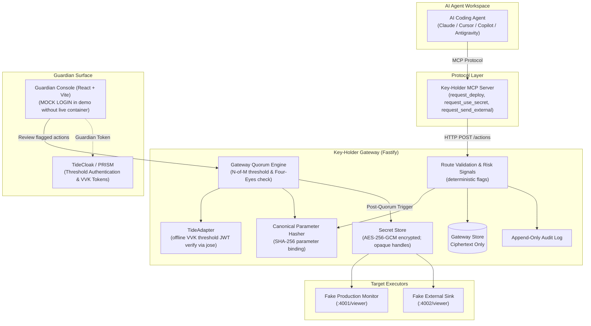

# Key-Holder Gateway

[](https://tide.org/tidecloak?utm_source=github&utm_medium=readme&utm_campaign=unlocked)
[](LICENSE)

> **Hackathon**: Tide × RMIT UNLOCKED — Theme: *Emergent Authority*
>
> A guardian-approval gateway between any AI coding agent and sensitive actions.
> No single party holds a master key — authority only forms when enough independent guardians approve.

---

## The Problem

AI coding agents (Claude Code, GitHub Copilot, Cursor, Google Antigravity, etc.) are increasingly autonomous. They read repositories, edit source files, run unit tests, and open pull requests.

However, today **the agent and the developer share the exact same authority level**. If an agent's context is poisoned by an indirect prompt injection attack (embedded in an untrusted issue, pull request, or documentation file), or if an individual developer credential is compromised, the attacker can:
- **Deploy unauthorized or malicious code** directly to production.
- **Exfiltrate environment secrets and credentials** across the network.
- **Send sensitive payload archives** to untrusted third-party endpoints.

There is currently no standard, vendor-neutral layer requiring **multiple independent humans** to agree before an autonomous agent executes a sensitive capability.

---

## The Solution: Emergent Authority

We build a **gateway** — not another agent — that intercepts sensitive operations between any MCP-capable AI agent and target environments.

```
Agent A ──┐
          ├──► KEY-HOLDER GATEWAY (MCP) ──► Mock Production Deploy
Agent B ──┘               │               ──► Encrypted Secret Vault
                          │               ──► External Data Sink
                          │
                   ┌──────▼──────┐
                   │ Guardian UI  │   (Guardians approve/reject with TideCloak identities)
                   └─────────────┘
```

- **Deny by default**: The MCP server exposes **strictly three sensitive tools**: `request_deploy`, `request_use_secret`, and `request_send_external`. Everyday developer tasks (reading files, writing tests, local builds) remain completely frictionless.
- **Emergent Authority via Quorum**: Sensitive actions produce an **Action Request** requiring an N-of-M guardian quorum (default 2-of-3) before the gateway triggers execution.
- **Parameter-Bound Hash**: Approvals cryptographically bind to a canonical SHA-256 hash of the action parameters. Any transit modification invalidates approval.
- **Secret Isolation**: Agents **never receive raw secrets**. The gateway mediates execution on behalf of approved requests and returns opaque ephemeral handles (`sec-handle-*`).
- **Why Agents Do Not Hold Tide Identities**: Autonomous agent processes cannot hold Tide identities or sign transactions directly because Tide authentication and cryptographic signing require a human-owned browser session (Web Enclave per GAP-064/GAP-063). Therefore, agents propose actions via MCP tools, and human guardians authenticate and approve in the browser.

---

## Architecture



---

## Real vs Enforced vs Mocked

This table provides the exact split between genuine Tide capabilities, gateway-enforced policies, and hackathon test scaffolding:

| Capability | Enforcement Layer | Status | Engineering Detail |
| :--- | :--- | :---: | :--- |
| **Threshold (PRISM) Authentication** | Genuine Tide | **Verified** | PRISM threshold password verification — no central password hash stored on any single server. |
| **VVK Threshold-Signed JWTs** | Genuine Tide | **Verified** | Validation Verification Key (VVK) threshold signatures issued by TideCloak ORK nodes. |
| **Offline JWT Verification** | Genuine Tide + Gateway | **Verified** | Verified locally using `jose` with embedded JWKS from realm adapter JSON (`config.jwk`), without remote cert lookups. |
| **N-of-M Quorum Enforcement** | Enforced by Gateway | **Verified** | Gateway tallies independent guardian approval tokens (2-of-3 threshold) and blocks unilateral action execution. |
| **Parameter-Hash Binding** | Enforced by Gateway | **Verified** | Canonical JSON SHA-256 hash (`parametersHash`). Approval signatures bind to this hash; mismatch immediately aborts execution (`HASH_MISMATCH`). |
| **Self-Approval Prevention** | Enforced by Gateway | **Verified** | Four-Eyes principle enforced in gateway (`SELF_APPROVAL` 409 rejection if `guardianId === proposer.userId`). |
| **Secret Isolation & Handles** | Enforced by Gateway | **Verified** | Agent receives only opaque ephemeral handles (`sec-handle-*`); plaintext secrets never touch agent context. |
| **Secret Store Encryption** | Enforced by Gateway | **Verified** | AES-256-GCM authenticated ciphertext stored in DB (encryption key held in process env / memory, NOT in DB). **NOT Tide tag encryption.** |
| **Guardian UI Login** | Guardian UI | **Mocked / Labeled** | **MOCK LOGIN**: Preconfigured guardian identities with simulated tokens. Displayed with prominent `MOCK LOGIN` label in UI and never claimed as live Tide auth. |
| **Production Target** | Mock Environment | **Mocked** | Stand-in HTTP service (`mock-env/fake-production` on port 4001) verifying release dispatch. |
| **External Exfiltration Target** | Mock Environment | **Mocked** | Stand-in HTTP sink (`mock-env/fake-external` on port 4002) verifying 0 bytes leaked. |
| **Secrets Fixture** | Mock Environment | **Mocked** | Labeled placeholder secrets (`mock-env/fixtures/fake-secrets.txt`) strictly carrying the `FAKE` marker. |

> [!NOTE]
> **No Ambiguous Claims**:
> - We do **not** claim "Tide enforces quorum" — the gateway quorum engine tallies approvals backed by Tide guardian identities.
> - We do **not** claim "Tide encrypts our secrets" — headless server secret storage uses AES-256-GCM authenticated encryption because Tide tag encryption requires client browser Web Enclave sessions.

---

## One-Command Quickstart

### Prerequisites
- Node.js >= 20.0.0
- npm >= 10.0.0
- Git Bash (on Windows) or Bash (on Linux/macOS)

### Start the Complete Demo Environment

```bash
# 1. Clone repository and install dependencies
git clone https://github.com/vohoangloc-32/TideCloak_Project.git
cd TideCloak_Project
make setup

# 2. Reset state and start all 4 services concurrently for recording
make demo
```

This single command resets the SQLite database and starts:
- **Key-Holder Gateway**: [http://localhost:3001](http://localhost:3001) (Health: `/health`)
- **Guardian Console UI**: [http://localhost:5173](http://localhost:5173)
- **Fake Production Monitor**: [http://localhost:4001/viewer](http://localhost:4001/viewer)
- **Fake External Sink**: [http://localhost:4002/viewer](http://localhost:4002/viewer)

---

## Demo Scenarios & Expected Results

Each scenario script runs against the live gateway. Scenarios print `[MOCK MODE]` **only** when `MOCK_MODE=1` is explicitly set, and **exit non-zero** if the real gateway is unreachable.

| # | Scenario | Command | Expected Result |
|---|----------|---------|-----------------|
| **1** | **Normal Agent Work** | `make demo-1`<br>`bash scripts/scenario-1-normal.sh` | Normal agent tasks (local tests in `sample-repo`, edits, builds) run freely without triggering any guardian approval or friction. Live gateway shows 0 pending approvals. |
| **2** | **Legit Deploy via 2-of-3 Quorum** | `make demo-2`<br>`bash scripts/scenario-2-legit-deploy.sh` | Agent requests deploy (`c0ffee1b4d89a234`). Guardian Alice approves &rarr; status pending (1/2). Guardian Bob approves &rarr; 2-of-3 quorum reached &rarr; deploy executes to fake production (`:4001/viewer`). |
| **3** | **Prompt Injection Defense** | `make demo-3`<br>`bash scripts/scenario-3-prompt-injection.sh` | Attacker injects malicious instruction into issue targeting `http://localhost:4002/receive`. Gateway flags risk signals (`unknown-destination`, `unusual-volume`). Shows **two outcomes**: (a) nobody approves & request expires; (b) one guardian actively rejects. In both: fake-external monitor shows **0 payloads** and agent never gets secret. |
| **4** | **Compromised Account Attack** | `make demo-4`<br>`bash scripts/scenario-4-manual-attacker.sh` | Single rogue user attempts to self-approve own secret request &rarr; gateway blocks with `SELF_APPROVAL (409)`. Rogue guardian Bob approves &rarr; status remains pending (1/2, quorum fails). DB inspection command confirms database holds **only ciphertext** with **NO key material**. |
| **5** | **Parameter Swap Tampering** | `make demo-5`<br>`bash scripts/scenario-5-param-swap.sh` | Alice approves benign deploy hash. Malicious actor attempts second approval with mutated parameter hash &rarr; gateway detects tamper and aborts with `HASH_MISMATCH (422)`. Action never executes. |

---

## Known Limitations

1. **Guardians Being Deceived / Social Engineering**: Quorum protects against rogue individuals and unauthorized agents, but cannot prevent human guardians from being socially engineered into approving an action.
2. **Hasty Review / Rubber-Stamping**: If 2 out of 3 guardians approve without carefully verifying commit hashes or destinations, the action will execute.
3. **Forgotten Gates**: The gateway only defends operations routed through its MCP tools (`request_deploy`, `request_use_secret`, `request_send_external`). Any un-intercepted side-channels outside the gateway remain unprotected.
4. **Pre-Existing Local Machine Secrets**: If secrets already reside in plain text within a local developer's `.bashrc`, unencrypted `.env`, or host files, an agent with local terminal execution can read them without calling the gateway. Secrets must be segregated behind the gateway interface.
5. **Simulated UI Session**: In the local demo without a running Docker engine, the Guardian UI uses simulated guardian profiles clearly labeled with **MOCK LOGIN**.

---

## Video Recording Checklist & Backup Plan

- [ ] Run `make demo` to ensure all 4 services are healthy.
- [ ] Verify split screen layout: Terminal on left (18pt font), Guardian UI on right (`http://localhost:5173`).
- [ ] Run `bash scripts/scenario-1-normal.sh` &rarr; show normal dev tests passing, 0 friction.
- [ ] Run `bash scripts/scenario-2-legit-deploy.sh` &rarr; show 0/2 &rarr; 1/2 &rarr; 2/2 &rarr; executed in UI and fake production viewer.
- [ ] Run `bash scripts/scenario-3-prompt-injection.sh` &rarr; show malicious issue, risk signal alerts, both outcomes (expiry & rejection), 0 payloads on fake-external.
- [ ] Run `bash scripts/scenario-4-manual-attacker.sh` &rarr; show `SELF_APPROVAL` 409 block, pending status, and DB ciphertext inspection.
- [ ] Run `bash scripts/scenario-5-param-swap.sh` &rarr; show `HASH_MISMATCH` 422 tamper rejection.
- [ ] **Backup Plan**: If live services experience port collisions or environment issues during recording, pass `MOCK_MODE=1` to run deterministic contract scenarios (`MOCK_MODE=1 bash scripts/scenario-2-legit-deploy.sh`), and clearly state offline mode. Record a complete take early.

---

## Quality Gates

Verify all quality checks pass from a clean state:
```bash
make lint && make typecheck && make test
```

---

## License

This project is licensed under the [MIT License](LICENSE).
Built at the Tide × RMIT UNLOCKED Hackathon, 2026.
